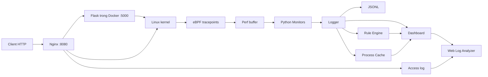
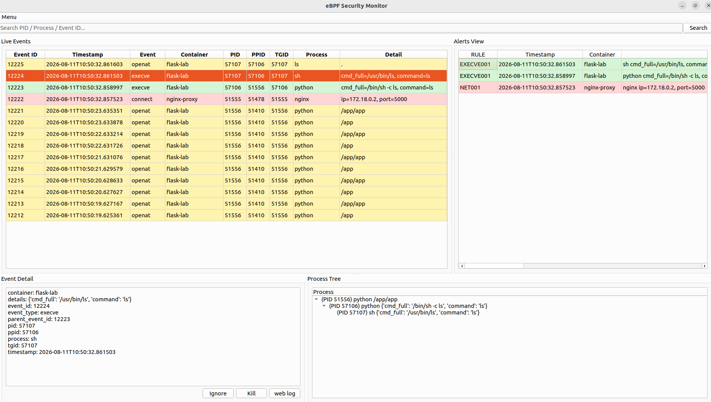

# Giám sát hành vi Web Shell bằng eBPF

Đồ án niên luận cơ sở An toàn thông tin: giám sát hoạt động của tiến trình trong Docker từ Linux kernel, phát hiện hành vi nghi vấn bằng luật và hỗ trợ truy vết qua giao diện desktop.

Tài liệu được tóm tắt từ [báo cáo khoa học `nlcs.pdf`](nlcs.pdf), đối chiếu với mã nguồn hiện tại.

## Chức năng chính

- Thu thập các sự kiện `execve`, `openat`, `connect`, `bind`, `listen` bằng eBPF/BCC.
- Nhận diện container theo cgroup, chuẩn hóa và ghi sự kiện dạng JSONL.
- Cảnh báo kết nối mạng, truy cập file nhạy cảm và thực thi lệnh trong tập luật.
- Hiển thị Live Events, Alerts View, Event Detail và Process Tree bằng PySide6.
- Hỗ trợ Ignore PID, Kill tiến trình và xem HTTP request gần thời điểm sự kiện.

## Kiến trúc tổng quan



Agent giám sát chạy trên **máy Linux host**; Flask và Nginx chạy trong Docker. Web Log Analyzer dùng khoảng thời gian **±10 giây** để tìm request có thể liên quan đến sự kiện.

## Cấu trúc mã nguồn

```text
.
├── project/                  # Hệ thống giám sát trên host
│   ├── main.py               # Khởi tạo và kết nối các thành phần
│   ├── ebpf/                 # Chương trình C gắn vào syscall tracepoints
│   ├── monitors/             # Nhận perf events, lọc và chuẩn hóa
│   ├── core/                 # Container, Logger, cache, filter, alert, action
│   ├── rule/                 # Đối chiếu sự kiện với luật JSON
│   ├── dashboard/            # Giao diện desktop PySide6
│   ├── web_log_analyzer/     # Đọc và hiển thị Nginx access log
│   ├── filter_controller/    # Công cụ thao tác PID qua CLI
│   └── data/                 # Cấu hình, luật và dữ liệu khi chạy
├── webserver/                # Flask mô phỏng thực thi lệnh qua web
├── reverse_proxy/            # Docker Compose, Nginx và access log
├── docs/                     # Kiến trúc, hướng dẫn và ảnh minh họa
├── start_system.sh           # Build image, chạy Compose và agent
└── nlcs.pdf                 # Báo cáo khoa học gốc
```

## Giao diện



Ảnh trích từ báo cáo `nlcs.pdf`. Xem thêm [giao diện và cách sử dụng](docs/USAGE.md).

## Bắt đầu

Chuẩn bị Linux có BCC/eBPF, Python 3, PySide6, watchdog, Flask, Docker và Docker Compose; sau đó chạy từ thư mục gốc:

```bash
bash start_system.sh
```

Truy cập web demo tại `http://localhost:8080`. Xem [hướng dẫn chạy](docs/USAGE.md) và [chi tiết kiến trúc](docs/ARCHITECTURE.md).

## Phạm vi hiện tại

Đây là hệ thống thử nghiệm phục vụ nghiên cứu. Web demo cho phép thực thi lệnh hệ điều hành, nên triển khai trong môi trường lab cô lập. Cảnh báo là dấu hiệu cần phân tích; hệ thống chưa phân tích chuỗi hành vi hay tự động chặn tấn công. Các giới hạn cụ thể được ghi trong [tài liệu kiến trúc](docs/ARCHITECTURE.md#giới-hạn-của-bản-hiện-tại).
