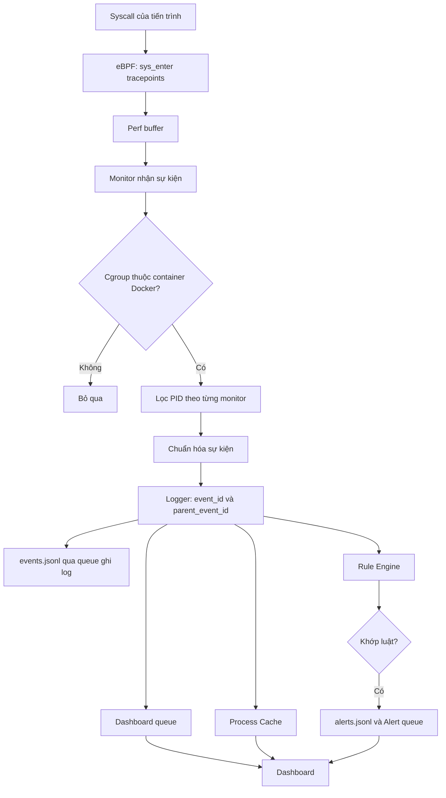
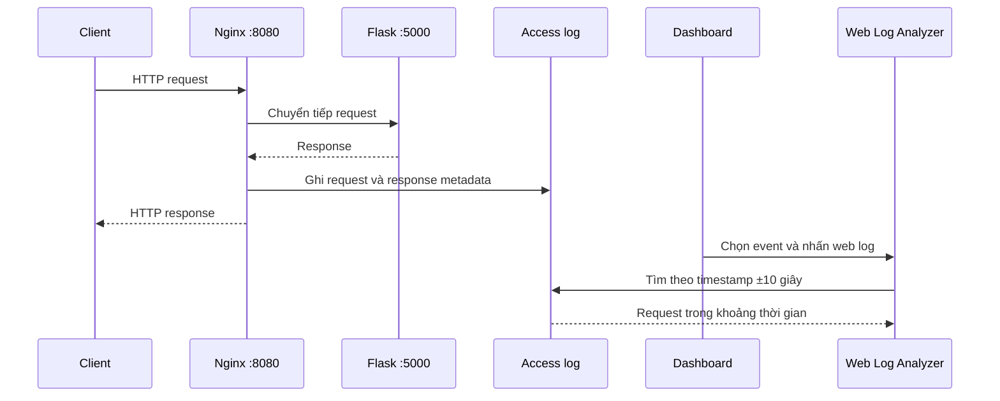

# Kiến trúc và luồng dữ liệu

Tóm tắt phần thiết kế hệ thống trong [nlcs.pdf](../nlcs.pdf), với mô tả hành vi theo mã nguồn hiện tại.

## Các thành phần

| Thành phần | Mã nguồn | Vai trò |
|---|---|---|
| Điều phối | [`main.py`](../project/main.py) | Khởi tạo manager, queue, monitor và Dashboard; chạy các luồng polling |
| eBPF Agent | [`ebpf/`](../project/ebpf/) | Thu thập syscall tại kernel, gửi dữ liệu qua perf buffer |
| Monitor | [`monitors/`](../project/monitors/) | Ánh xạ container, lọc sự kiện, giải mã và chuẩn hóa dữ liệu |
| ContainerManager | [`container_manager.py`](../project/core/container_manager.py) | Lấy danh sách container Docker, ánh xạ cgroup ID → tên; làm mới mỗi 60 giây |
| Logger | [`logger.py`](../project/core/logger.py) | Gán ID, liên kết sự kiện cha, ghi log và phân phối dữ liệu |
| Rule Engine | [`rule/`](../project/rule/) | So sánh từng sự kiện với tập luật trong JSON |
| AlertManager | [`alert_manager.py`](../project/core/alert_manager.py) | Ghi cảnh báo và đưa vào queue cho Dashboard |
| ProcessCache | [`process_cache.py`](../project/core/process_cache.py) | Lưu sự kiện và quan hệ cha–con để dựng cây |
| Filter / Action | [`core/`](../project/core/) | Theo dõi danh sách Ignore PID, cập nhật cấu hình và Kill thủ công |
| Dashboard | [`dashboard/`](../project/dashboard/) | Hiển thị sự kiện, cảnh báo, chi tiết và cây tiến trình |
| Web Log Analyzer | [`web_log_analyzer/`](../project/web_log_analyzer/) | Tìm HTTP request gần thời điểm sự kiện trong Nginx access log |

## Luồng xử lý

`openat` còn lọc một số đường dẫn gây nhiễu ngay trong chương trình C. Các Monitor bỏ sự kiện ngoài container; riêng `ConnectMonitor` hiện chưa áp dụng danh sách Ignore PID.

## Sự kiện và lưu trữ

| Loại sự kiện | Nội dung `details` |
|---|---|
| `execve` | `cmd_full`, `command` |
| `openat` | Chuỗi đường dẫn file |
| `connect`, `bind` | `ip`, `port` (IPv4) |
| `listen` | `fd`, `backlog` |

Mỗi sự kiện có `timestamp`, `event_type`, `container`, `pid`, `tgid`, `ppid`, `process`, `details`; Logger bổ sung `event_id` và `parent_event_id`.

- `project/data/events.jsonl`: mỗi dòng là một sự kiện JSON.
- `project/data/alerts.jsonl`: sự kiện khớp luật, bổ sung ID, tên và mô tả luật.
- `project/data/state.json`: lưu bộ đếm Event ID.
- `project/data/filter.json`: danh sách `ignored_pids`, được watchdog theo dõi thay đổi.
- `project/data/rules/rules.json`: cấu hình phát hiện, nạp khi khởi tạo Rule Engine.

`event_id` định danh **sự kiện**. Logger dùng ánh xạ PID → Event ID gần nhất để tìm cha qua PPID; ProcessCache dùng các liên kết này để dựng cây phục vụ truy vết.

## Luật phát hiện

| Nhóm | Điều kiện đang được thực thi |
|---|---|
| Connect | Mọi sự kiện `connect` đã qua bộ lọc container |
| File | `openat` có đường dẫn khớp chính xác `/etc/passwd`, `/etc/shadow`, `/var/log/auth.log`, `flag.txt` |
| Execve | `command` khớp chính xác `cat`, `ls`, `whoami`, `id`, `nc`, `curl`, `wget` |

Engine trả về luật khớp đầu tiên. Các trường `enabled`, `severity`, `response.action`, whitelist địa chỉ và kiểu truy cập file chưa được áp dụng trong logic kiểm tra. Cảnh báo không tự thực hiện `SUSPEND` hay chặn kết nối; Kill được người dùng chọn trên Dashboard.

## Bổ sung ngữ cảnh HTTP

Analyzer hiển thị IP nguồn, phương thức, URL, status, kích thước và chi tiết HTTP. Đây là tương quan theo thời gian để hỗ trợ điều tra; chưa chứng minh một request cụ thể gây ra syscall.

## Giới hạn của bản hiện tại

- Luật xét từng sự kiện độc lập; các hoạt động hợp lệ như Nginx kết nối Flask cũng có thể tạo cảnh báo.
- Probe nằm ở `sys_enter`: ghi nhận lời gọi, chưa xác nhận syscall thành công hay thất bại.
- Connect và Bind chỉ thu thập IPv4; đối số lệnh và đường dẫn có giới hạn độ dài.
- Ánh xạ PID của Logger giữ tối đa 100 mục gần nhất, ProcessCache giữ tối đa 1.000 sự kiện; cây có thể thiếu lịch sử. PID tái sử dụng và nhiều sự kiện cùng PID có thể ảnh hưởng liên kết.
- Timestamp eBPF được gán khi Monitor xử lý ở user space; Analyzer mặc định UTC+7 khi timestamp không có múi giờ.

Hướng phát triển trong báo cáo: phân tích chuỗi hành vi, tăng khả năng tìm kiếm web log và bổ sung cơ chế đánh giá/phản ứng tự động.
