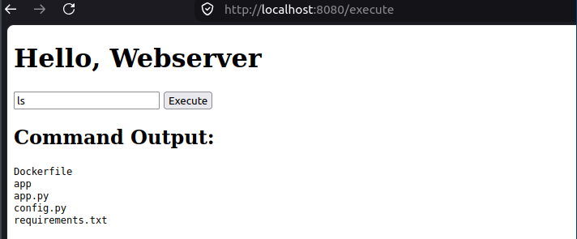
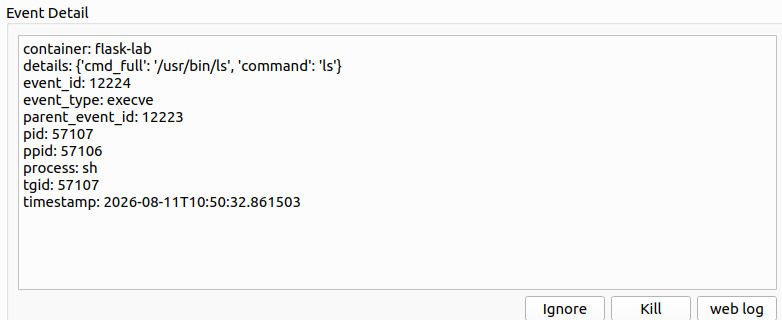
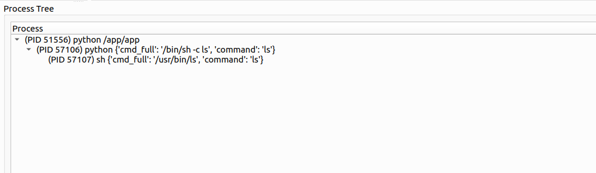
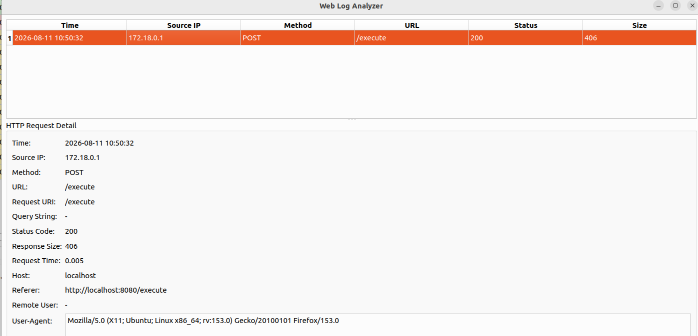

# Chạy và sử dụng bản demo

## Chuẩn bị

- Máy Linux có kernel hỗ trợ eBPF và syscall tracepoints, BCC Python bindings cùng các thành phần biên dịch/kernel headers phù hợp.
- Python 3 với `bcc`, `PySide6`, `watchdog`, `Flask` trong môi trường Python dùng để chạy agent. `bcc` ở đây là bindings của BCC, cần cài theo bản phân phối Linux.
- Docker Engine, Docker Compose, `curl`; tài khoản chạy script có quyền sử dụng Docker.
- Phiên desktop có thể mở cửa sổ Qt; quyền root để nạp chương trình eBPF.

`webserver/requirements.txt` chỉ chứa dependency của Flask demo. Project giám sát hiện chưa có file dependency riêng. `start_system.sh` hỗ trợ build và khởi động, chưa tự cài các dependency trên.

Web demo cố ý thực thi lệnh người dùng nhập để mô phỏng Web Shell. Dùng trong lab cô lập; Compose hiện publish cổng `8080` trên các interface của host.

## Chạy bằng script

Từ thư mục gốc repository:

```bash
bash start_system.sh
```

Script build image `flask-webserver`, dừng Compose cũ của lab, chạy Flask + Nginx, kiểm tra HTTP rồi chạy `project/main.py` bằng `sudo` khi cần. Mở `http://localhost:8080` để dùng web demo.

## Chạy từng thành phần

Chạy lần lượt từ thư mục gốc:

```bash
# Build ứng dụng Flask
docker build -t flask-webserver ./webserver

# Khởi động Flask và reverse proxy
docker compose -f reverse_proxy/docker-compose.yml up -d

# Agent dùng đường dẫn tương đối, cần chạy trong project/
cd project
sudo python3 main.py
```

Nếu dùng môi trường Python riêng, cần chọn interpreter có đủ dependency thay cho `python3`. Máy chạy agent cần truy cập được Docker, `/proc` và `/sys/fs/cgroup` để nhận diện container.

## Quan sát trên Dashboard

1. Nhập lệnh đơn giản như `whoami` hoặc `ls` trên web demo.
2. Xem sự kiện trong **Live Events** và luật khớp trong **Alerts View**.
3. Chọn sự kiện để xem **Event Detail** và **Process Tree**.
4. Nhấn **web log** để tìm HTTP request trong khoảng ±10 giây.

**Ignore** thêm PID vào cấu hình bỏ qua; hiện áp dụng cho Exec, Open, Bind và Listen. **Kill** gửi `SIGKILL` thủ công nếu PID vẫn tồn tại.

### Web demo



### Chi tiết sự kiện và cây tiến trình





### Web Log Analyzer



Các ảnh được trích nguyên bản từ [nlcs.docx](../nlcs.docx), minh họa phiên demo trong báo cáo.

## Dừng hệ thống

Đóng Dashboard hoặc dừng agent bằng `Ctrl+C`. Từ thư mục gốc, chạy lệnh sau để dừng container lab; bước dọn dẹp cuối script có thể không chạy nếu bị ngắt hoặc gặp lỗi:

```bash
docker compose -f reverse_proxy/docker-compose.yml down
```


